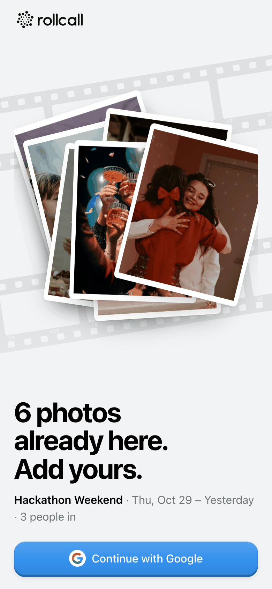
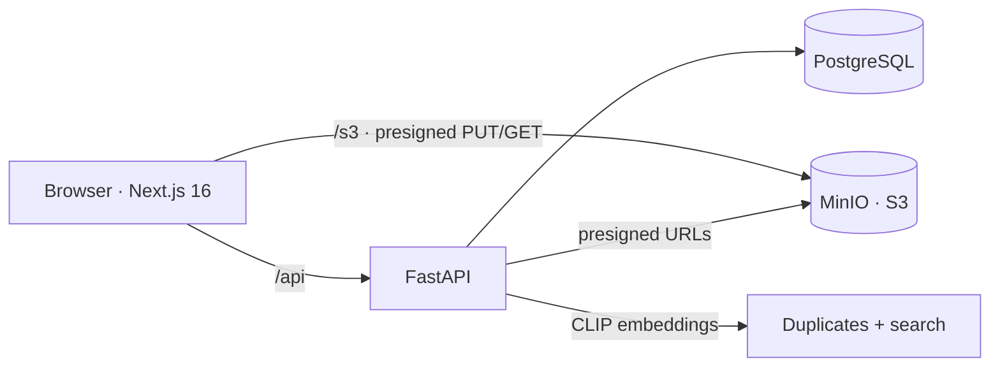

<p align="center">
  <picture>
    <source media="(prefers-color-scheme: dark)" srcset="docs/brand/rollcall-horizontal-dark.svg">
    
  </picture>
</p>

<p align="center">
  <b>One shared photo roll for every event.</b><br>
  Create an event, show the QR code, and everyone's photos end up in one album.
</p>

<p align="center">
  
  
  
  
  
  
  
  
  
  
</p>

<table>
  <tr>
    <td align="center"><br><sub>One tap with Google</sub></td>
    <td align="center"><br><sub>What a guest sees after scanning</sub></td>
    <td align="center"><br><sub>One album, everyone's photos</sub></td>
    <td align="center"><br><sub>Dark mode</sub></td>
  </tr>
</table>

---

## The problem

After every party, trip or wedding the photos are scattered across ten camera rolls and three chat apps. Someone
always has the best shot and nobody remembers who. RollCall gives the event **one code and one button**: guests scan,
drop in their photos, and everyone can browse and save the full set afterwards. No feeds, no followers, no editing.

## What you get

| Feature | Details |
| --- | --- |
| **Join in seconds** | Every event has a 6-character code and a QR that opens `/join/<CODE>`. A guest goes from scan to uploading in under a minute. |
| **Batch uploads** | Pick many photos at once, or shoot with the in-app camera. Photos and videos (up to 200 MB) upload straight to S3 with progress and plain failure messages. HEIC photos get a JPEG preview. |
| **One shared album** | Members see everything, and the album updates live as others upload. Saving always gives you the **original**, one photo at a time or the whole album as a zip with **Save all**. |
| **Search by meaning** | Type "dog", "sunset" or "laptop" (in 50+ languages) and CLIP finds matching photos, no tags needed. |
| **Duplicates tucked away** | Near-identical shots and re-sent copies are grouped, the sharpest one stays in front, and the rest are one tap away. |
| **Private by default** | Only members see an event. Authors delete their own photos, the host can delete any, and the host can edit or delete the event. |
| **Built for phones** | Mobile-first, installable web app, 44 px touch targets, light and dark mode, respects reduced motion. |

## How it works



- **Auth:** our own "Continue with Google" button opens Google's OAuth popup (GIS token client) → `POST /api/auth/google`
  checks the access token was issued to our client ID, reads the profile, and sets an httpOnly `session` cookie (JWT, 30 days).
- **Uploads:** the browser asks `POST /api/uploads` for presigned PUT URLs, uploads the original plus a 600 px thumbnail
  straight to S3, then registers the photo. Originals are kept.
- **Joining:** each event has a 6-character code; the QR encodes `https://<host>/join/<CODE>`. Before signing in, a guest
  sees only the cover and counts, never the photos.
- **Smart album:** after each upload the API computes a perceptual hash, sharpness and a CLIP embedding per photo.
  Duplicates are grouped by hash or by "same moment + very similar embedding"; search embeds the query text into the same
  space and ranks by cosine similarity.
- **One origin:** Next.js proxies `/api` → FastAPI and `/s3` → MinIO, so the browser only talks to one origin and the
  session cookie just works.

## Tech stack

| Layer | Technology |
| --- | --- |
| **Web** | Next.js 16 (App Router), React 19, TypeScript, Tailwind CSS 4, `qrcode.react` |
| **API** | FastAPI, SQLAlchemy 2, PyJWT, boto3, Pillow + pillow-heif, managed with [`uv`](https://docs.astral.sh/uv/) |
| **AI** | `sentence-transformers` CLIP (`clip-ViT-B-32` + multilingual text model), `imagehash`, NumPy |
| **Data** | PostgreSQL 17, MinIO (S3-compatible object storage) |
| **Dev** | Docker Compose for Postgres and MinIO, pytest + httpx for the API |

## Repository layout

```
web/                 Next.js app: pages (app/), UI components (components/), API client (lib/)
api/
  main.py            FastAPI app: auth, events, join codes, presigned uploads, photos
  photo_ai.py        glue between uploads and the analysis code
  gather/            duplicate grouping, CLIP embedder, semantic search, photo features
  test_main.py       API tests
docker-compose.yml   Postgres :5432 and MinIO :9000 (console :9001)
docs/                screenshots and logos used in this README
PRODUCT.md           who it's for and what it must do
DESIGN.md            design tokens and UI rules
```

## Run locally

You need Docker, [`uv`](https://docs.astral.sh/uv/) and Node.js.

1. **Google sign-in.** In Google Cloud Console → Credentials, create an **OAuth client ID (Web application)** and add
   `http://localhost:3000` to *Authorized JavaScript origins*.
2. **Env files.**
   ```bash
   cp api/.env.example api/.env        # set GOOGLE_CLIENT_ID and JWT_SECRET
   cp web/.env.example web/.env.local  # set NEXT_PUBLIC_GOOGLE_CLIENT_ID (same client ID)
   ```
3. **Start everything.**
   ```bash
   docker compose up -d                                              # Postgres :5432, MinIO :9000 (console :9001)
   cd api && uv run uvicorn main:app --reload --env-file .env --port 8000
   cd web && npm install && npm run dev                              # http://localhost:3000
   ```
   Tables and the bucket are created on API start. The first start also downloads the CLIP models in the background.

Run the API tests with `cd api && uv run pytest`.

### Testing on a phone

Google only allows sign-in from `localhost` or HTTPS origins, so expose the dev server over HTTPS
(e.g. `cloudflared tunnel --url http://localhost:3000`) and add that URL to the OAuth client's origins.

## Production notes

- Set `COOKIE_SECURE=true`, a long random `JWT_SECRET`, and serve over HTTPS.
- Uploads through the `/s3` rewrite are buffered by Next.js (up to 205 MB each). At scale, point `S3_PUBLIC_URL`
  at the bucket's public endpoint and configure bucket CORS so uploads bypass Next.
- The `minio/minio` Docker images are no longer published; compose uses `cgr.dev/chainguard/minio`.
