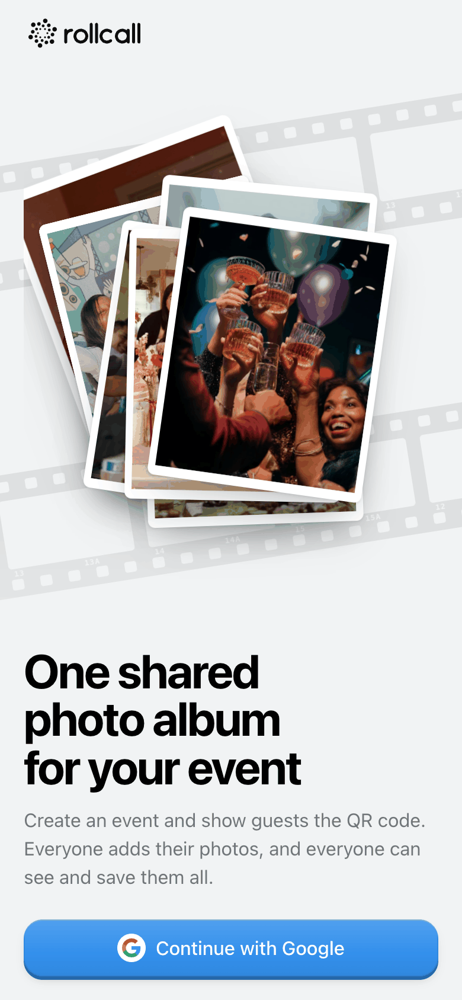
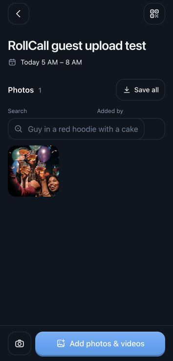
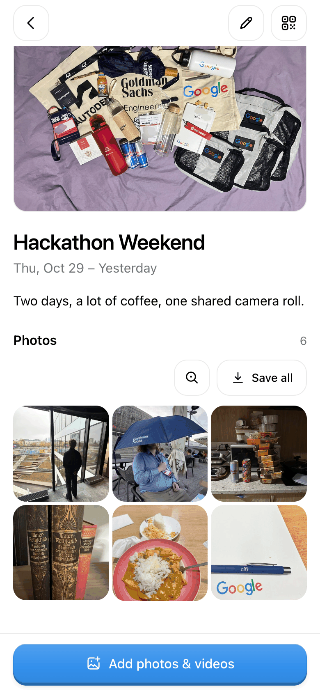
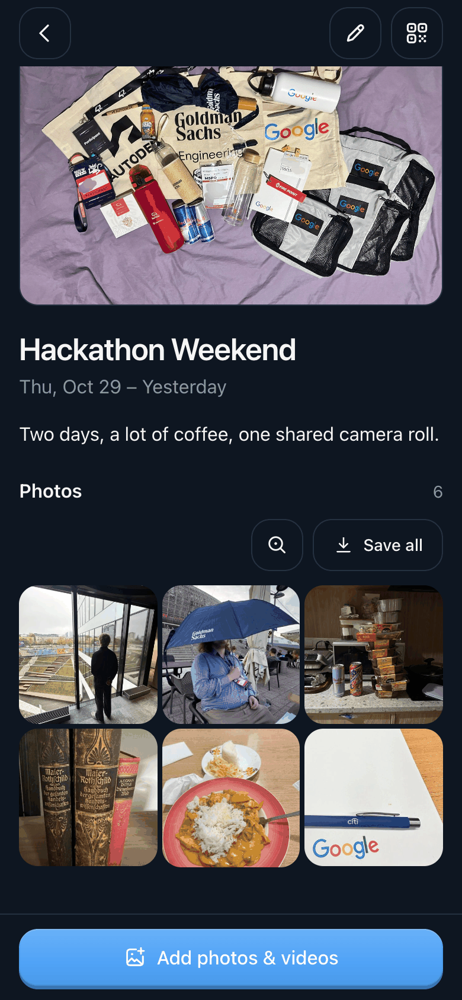
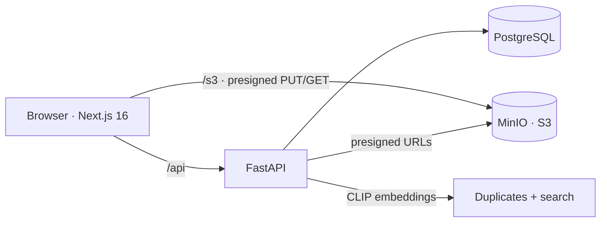

<p align="center">
  <picture>
    <source media="(prefers-color-scheme: dark)" srcset="docs/brand/rollcall-horizontal-dark.svg">
    
  </picture>
</p>

<p align="center">
  <b>One shared photo roll for every event.</b><br>
  Create an event, show the QR code, and everyone's photos end up in one album.
</p>

<p align="center">
  
  
  
  
  
  
  
  
  
  
</p>

<table>
  <tr>
    <td align="center"><br><sub>One tap with Google</sub></td>
    <td align="center"><br><sub>Guests open the album without an account</sub></td>
    <td align="center"><br><sub>One album, everyone's photos</sub></td>
    <td align="center"><br><sub>Dark mode</sub></td>
  </tr>
</table>

---

## The problem

After every party, trip or wedding the photos are scattered across ten camera rolls and three chat apps. Someone
always has the best shot and nobody remembers who. RollCall gives the event **one code and one button**: guests scan,
drop in their photos, and everyone can browse and save the full set afterwards. No feeds, no followers, no editing.

## What you get

| Feature | Details |
| --- | --- |
| **Join without an account** | Every event has a 6-character code and a QR that opens `/join/<INVITE_TOKEN>`. The browser creates a guest session and opens the album automatically. No Google sign-in or separate join button for guests. |
| **Batch uploads** | Pick many photos at once, or shoot with the in-app camera. Photos and videos (up to 200 MB) upload straight to S3 with progress and plain failure messages. HEIC photos get a JPEG preview. |
| **One shared album** | Members see everything, and the album updates live as others upload. Saving always gives you the **original**, one photo at a time or the whole album as a zip with **Save all**. |
| **Search by meaning** | Type "dog", "sunset" or "laptop" (in 50+ languages) and CLIP finds matching photos, no tags needed. |
| **Duplicates tucked away** | Near-identical shots and re-sent copies are grouped, the sharpest one stays in front, and the rest are one tap away. |
| **Private by default** | Only members see an event. Authors delete their own photos, the host can delete any, and the host can edit or delete the event. |
| **Built for phones** | Mobile-first, installable web app, 44 px touch targets, light and dark mode, respects reduced motion. |

## How it works



- **Auth:** hosts use "Continue with Google". `POST /api/auth/google` checks the token's client ID and verified profile,
  then sets an httpOnly `session` cookie (JWT, 30 days). Guest invitations create a guest identity and the same kind of
  cookie without Google. Signing in later preserves the guest's memberships and photo ownership.
- **Uploads:** the browser asks `POST /api/uploads` for event-scoped upload targets, uploads the original plus a 600 px
  thumbnail straight to S3, then registers the photo. Guest targets use signed POST policies with file-size limits.
  The server checks event membership, upload permissions and ownership. The primary button opens the file picker directly.
- **Joining:** the QR encodes `https://<host>/join/<INVITE_TOKEN>` with a random 192-bit token. The client POSTs to join,
  receives its guest cookie, and opens the album. GET/prefetch alone never creates a guest or grants album access.
  Legacy `/join/<CODE>` links and manual short codes still work. Anyone with a valid invitation can join; the host can
  close new invitations, replace the QR link, or pause uploads in the invite panel.
- **Guest limits:** 500 registered uploads per guest per event, 120 upload-target requests per guest per minute,
  60 short-code join attempts per server-observed IP per minute, and 300 new guest identities per IP per minute.
  Rate limits are in-memory per API process; a multi-worker deployment should use a shared limiter and trusted proxy IP configuration.
- **Guest recovery:** the browser remembers authorship for 30 days. Clearing cookies or switching devices creates a new
  guest identity; old photos remain, and the host can remove them. Signing in with Google on the original device preserves authorship.
- **Database:** Alembic migrations run on API startup and preserve existing users, events, photos and memberships.
  PostgreSQL migration startup uses a transaction-level advisory lock. To migrate explicitly, run
  `cd api && uv run --env-file .env python migrate.py`.
- **Smart album:** after each upload the API computes a perceptual hash, sharpness and a CLIP embedding per photo.
  Duplicates are grouped by hash or by "same moment + very similar embedding"; search embeds the query text into the same
  space and ranks by cosine similarity.
- **One origin:** Next.js proxies `/api` → FastAPI and `/s3` → MinIO, so the browser only talks to one origin and the
  session cookie just works.

## Tech stack

| Layer | Technology |
| --- | --- |
| **Web** | Next.js 16 (App Router), React 19, TypeScript, Tailwind CSS 4, `qrcode.react` |
| **API** | FastAPI, SQLAlchemy 2, PyJWT, boto3, Pillow + pillow-heif, managed with [`uv`](https://docs.astral.sh/uv/) |
| **AI** | `sentence-transformers` CLIP (`clip-ViT-B-32` + multilingual text model), `imagehash`, NumPy |
| **Data** | PostgreSQL 17, MinIO (S3-compatible object storage) |
| **Dev** | Docker Compose for Postgres and MinIO, pytest + httpx for the API |

## Repository layout

```
web/                 Next.js app: pages (app/), UI components (components/), API client (lib/)
api/
  main.py            FastAPI app: auth, events, join codes, presigned uploads, photos
  photo_ai.py        glue between uploads and the analysis code
  gather/            duplicate grouping, CLIP embedder, semantic search, photo features
  test_main.py       API tests
docker-compose.yml   Postgres :5432 and MinIO :9000 (console :9001)
docs/                screenshots and logos used in this README
PRODUCT.md           who it's for and what it must do
DESIGN.md            design tokens and UI rules
```

## Run locally

You need Docker, [`uv`](https://docs.astral.sh/uv/) and Node.js.

1. **Google sign-in.** In Google Cloud Console → Credentials, create an **OAuth client ID (Web application)** and add
   `http://localhost:3000` to *Authorized JavaScript origins*.
2. **Env files.**
   ```bash
   cp api/.env.example api/.env        # set GOOGLE_CLIENT_ID and JWT_SECRET
   cp web/.env.example web/.env.local  # set NEXT_PUBLIC_GOOGLE_CLIENT_ID (same client ID)
   ```
3. **Start everything.**
   ```bash
   docker compose up -d                                              # Postgres :5432, MinIO :9000 (console :9001)
   cd api && uv run uvicorn main:app --reload --env-file .env --port 8000
   cd web && npm install && npm run dev                              # http://localhost:3000
   ```
   Database migrations and bucket setup run on API start. The first start also downloads the CLIP models in the background.

Run the API tests with `cd api && uv run pytest`.

### Testing on a phone

Google only allows sign-in from `localhost` or HTTPS origins, so expose the dev server over HTTPS
(e.g. `cloudflared tunnel --url http://localhost:3000`) and add that URL to the OAuth client's origins.

## Production notes

- Set `COOKIE_SECURE=true`, a long random `JWT_SECRET`, and serve over HTTPS.
- Uploads through the `/s3` rewrite are buffered by Next.js (up to 205 MB each). At scale, point `S3_PUBLIC_URL`
  at the bucket's public endpoint and configure bucket CORS so uploads bypass Next.
- The `minio/minio` Docker images are no longer published; compose uses `cgr.dev/chainguard/minio`.
